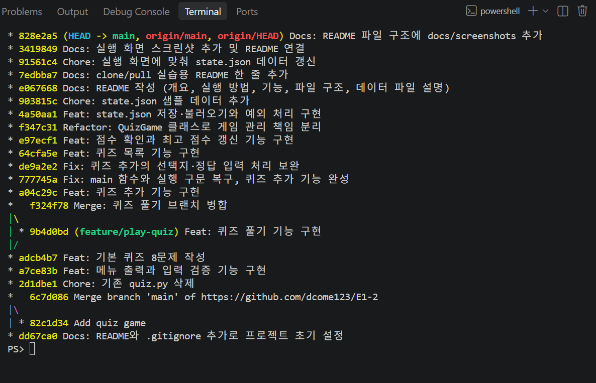
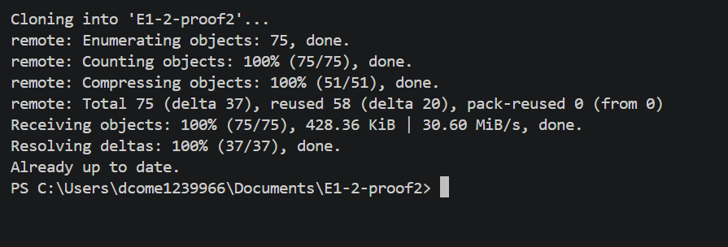

# 나만의 퀴즈 게임

터미널에서 동작하는 Python 콘솔 퀴즈 게임입니다.
메뉴에서 번호를 선택해 퀴즈를 풀고, 새 퀴즈를 추가하고, 최고 점수를 확인할 수 있습니다.
프로그램을 종료해도 추가한 퀴즈와 최고 점수가 `state.json` 파일에 저장되어 유지됩니다.

## 프로젝트 개요

- Python 기본 문법과 클래스(객체 지향)로 만든 콘솔 프로그램입니다.
- 외부 라이브러리 없이 표준 라이브러리(`json`, `pathlib`)만 사용합니다.
- Git과 GitHub로 기능 단위 커밋, 브랜치 작업, 병합, clone/pull을 경험하며 개발했습니다.

## 퀴즈 주제와 선정 이유

- **주제**: 코딩, 인공지능 기초, 인공지능 학습방법, 데이터의 종류
- **선정 이유**: 초등 교육 현장에서 활용하기 위해 선택했습니다. 초등학생부터 성인까지 함께 풀 수 있도록 쉬운 말로 된 문제를 구성했습니다.

## 실행 방법

필요한 환경: Python 3.10 이상 (외부 라이브러리 설치 불필요)

```bash
git clone https://github.com/dcome123/E1-2.git
cd E1-2
python main.py
```

## 기능 목록

| 메뉴 | 기능 |
|---|---|
| 1. 퀴즈 풀기 | 저장된 퀴즈를 모두 출제하고 정답 여부와 결과(100점 만점)를 보여줍니다. 최고 점수와 비교해 갱신합니다. |
| 2. 퀴즈 추가 | 문제, 선택지 4개, 정답 번호를 입력해 새 퀴즈를 등록하고 파일에 저장합니다. |
| 3. 퀴즈 목록 | 등록된 퀴즈의 문제를 번호와 함께 보여줍니다. 퀴즈가 없으면 안내 문구를 보여줍니다. |
| 4. 점수 확인 | 최고 점수를 보여줍니다. 아직 퀴즈를 풀지 않았다면 안내 문구를 보여줍니다. |
| 5. 종료 | 데이터를 저장하고 프로그램을 종료합니다. |

추가 기능

- 입력 검사: 앞뒤 공백 제거, 빈 입력, 숫자가 아닌 입력, 범위 밖 숫자는 안내 후 다시 입력받습니다.
- 안전한 종료: `Ctrl+C`나 입력 스트림 종료가 발생해도 안내 문구를 보여주고 저장 후 종료합니다.
- 데이터 파일 복구: `state.json`이 없으면 기본 퀴즈로 시작하고, 손상되었으면 안내 후 기본 퀴즈로 초기화합니다.

## 파일 구조

```text
E1-2/
├── main.py        # 프로그램 전체 코드 (Quiz, QuizGame 클래스, 실행 진입점)
├── state.json     # 퀴즈와 최고 점수 저장 파일
├── README.md      # 프로젝트 설명
├── .gitignore     # Git이 기록하지 않을 파일 목록
└── docs/screenshots/  # 실행 화면 스크린샷
```

`main.py`의 구성

| 이름 | 역할 |
|---|---|
| `Quiz` 클래스 | 퀴즈 한 문제(문제, 선택지, 정답). 출력, 정답 확인, 저장용 변환 담당 |
| `QuizGame` 클래스 | 게임 전체 관리. 메뉴, 퀴즈 풀기/추가/목록, 점수, 파일 저장/불러오기 담당 |
| `read_int`, `read_text` | 입력 처리와 검사 |
| `create_default_quizzes` | 기본 퀴즈 8문제 생성 |
| `quiz_from_dict` | 저장된 데이터를 `Quiz` 객체로 변환하고 형식을 검사 |

## 데이터 파일 설명 (state.json)

- **경로**: 프로젝트 루트의 `state.json` (`main.py`와 같은 폴더)
- **인코딩**: UTF-8
- **역할**: 프로그램을 종료해도 퀴즈 목록과 최고 점수가 유지되도록 저장합니다.
- **저장 시점**: 퀴즈 추가, 최고 점수 갱신, 프로그램 종료 시

| 필드 | 형식 | 설명 |
|---|---|---|
| `quizzes` | 리스트 | 퀴즈 목록 |
| `quizzes[].question` | 문자열 | 문제 |
| `quizzes[].choices` | 문자열 4개의 리스트 | 선택지 |
| `quizzes[].answer` | 정수 1~4 | 정답 번호 |
| `best_score` | 정수 또는 `null` | 최고 점수(100점 만점). 아직 푼 적이 없으면 `null` |

```json
{
    "quizzes": [
        {
            "question": "사진이나 그림처럼 눈으로 보는 데이터를 무엇이라고 할까요?",
            "choices": ["소리 데이터", "숫자 데이터", "글자 데이터", "이미지 데이터"],
            "answer": 4
        }
    ],
    "best_score": 100
}
```

파일이 없으면 기본 퀴즈로 시작하고, 손상되었으면 안내 후 기본 퀴즈로 초기화합니다.
> clone/pull 실습으로 추가한 한 줄입니다.

## 실행 화면

### 메뉴


### 퀴즈 풀기


### 퀴즈 추가


### 퀴즈 목록


### 점수 확인


## 설계 이유

- **클래스를 쓴 이유**: 퀴즈 한 문제(`Quiz`)와 게임 진행(`QuizGame`)의 역할을 나누어 각 클래스가 한 가지 일만 맡게 했습니다(추상화). 문제를 추가하거나 저장 방식을 바꿔도 `Quiz`를 그대로 다시 쓸 수 있습니다(재사용).
- **JSON을 쓴 이유**: 사람이 열어서 읽을 수 있고(가독성), 문제·보기·정답 같은 구조를 그대로 표현할 수 있으며(구조화), 표준 라이브러리 `json`만으로 읽고 쓸 수 있습니다.

## Git 작업 방식

- **커밋 단위**: 기능 하나 또는 문서 한 묶음을 끝낼 때마다 커밋합니다.
- **메시지 형식**: `종류: 한 줄 설명` 입니다. 종류는 `Feat`(기능), `Fix`(수정), `Docs`(문서), `Chore`(기타)를 씁니다. 예: `Docs: README 파일 구조에 docs/screenshots 추가`
- **브랜치**: `feature/play-quiz`에서 퀴즈 풀기 기능을 만든 뒤 `git merge --no-ff`로 `main`에 병합했습니다.

## Git 작업 증빙

커밋 목록과 브랜치 병합 모양입니다. 작성 시점 기준이며 `git log --oneline --graph`의 출력입니다.

```text
* 3dba15f Docs: 개발 환경 및 git log 스크린샷 추가
* 828e2a5 Docs: README 파일 구조에 docs/screenshots 추가
* 3419849 Docs: 실행 화면 스크린샷 추가 및 README 연결
* 91561c4 Chore: 실행 화면에 맞춰 state.json 데이터 갱신
* 7edbba7 Docs: clone/pull 실습용 README 한 줄 추가
* e067668 Docs: README 작성 (개요, 실행 방법, 기능, 파일 구조, 데이터 파일 설명)
* 903815c Chore: state.json 샘플 데이터 추가
* 4a50aa1 Feat: state.json 저장·불러오기와 예외 처리 구현
* f347c31 Refactor: QuizGame 클래스로 게임 관리 책임 분리
* e97ecf1 Feat: 점수 확인과 최고 점수 갱신 기능 구현
* 64cfa5e Feat: 퀴즈 목록 기능 구현
* de9a2e2 Fix: 퀴즈 추가의 선택지·정답 입력 처리 보완
* 777745a Fix: main 함수와 실행 구문 복구, 퀴즈 추가 기능 완성
* a04c29c Feat: 퀴즈 추가 기능 구현
*   f324f78 Merge: 퀴즈 풀기 브랜치 병합
|\  
| * 9b4d0bd Feat: 퀴즈 풀기 기능 구현
|/  
* adcb4b7 Feat: 기본 퀴즈 8문제 작성
* a7ce83b Feat: 메뉴 출력과 입력 검증 기능 구현
* 2d1dbe1 Chore: 기존 quiz.py 삭제
*   6c7d086 Merge branch 'main' of https://github.com/dcome123/E1-2
|\  
| * 82c1d34 Add quiz game
* dd67ca0 Docs: README와 .gitignore 추가로 프로젝트 초기 설정
```



전체 커밋은 [GitHub 커밋 내역](https://github.com/dcome123/E1-2/commits/main)에서도 볼 수 있습니다.

## 한계와 개선 방향

- 모든 퀴즈를 리스트로 메모리에 올리고, 저장할 때마다 JSON 파일 전체를 다시 씁니다. 수백 개 수준은 문제없을 것으로 보지만 1000개 이상은 직접 측정하지 않았습니다.
- 퀴즈가 많아지면 목록 출력이 길어지고 저장이 느려질 수 있습니다. 그때는 목록을 나누어 보여 주기(페이징)나 표준 라이브러리 `sqlite3`(DB)로 옮기는 방법을 고려할 수 있습니다.

## 요구사항이 바뀌면 고칠 곳

| 바꾸고 싶은 것 | 고칠 곳 |
| --- | --- |
| 점수 계산 방식 | `calc_score`, `update_best_score` |
| 퀴즈 형식(보기 개수 등) | `Quiz` 클래스, `quiz_from_dict`, `add_quiz` |
| 저장하는 데이터 항목 | `save_state`, `load_state`, `state.json` |
| 입력 규칙 | `read_int`, `read_text` |
| 기본 퀴즈 내용·개수 | `create_default_quizzes` |
| 메뉴 추가·변경 | `show_menu`, `run` |
## clone / pull 실행 화면


